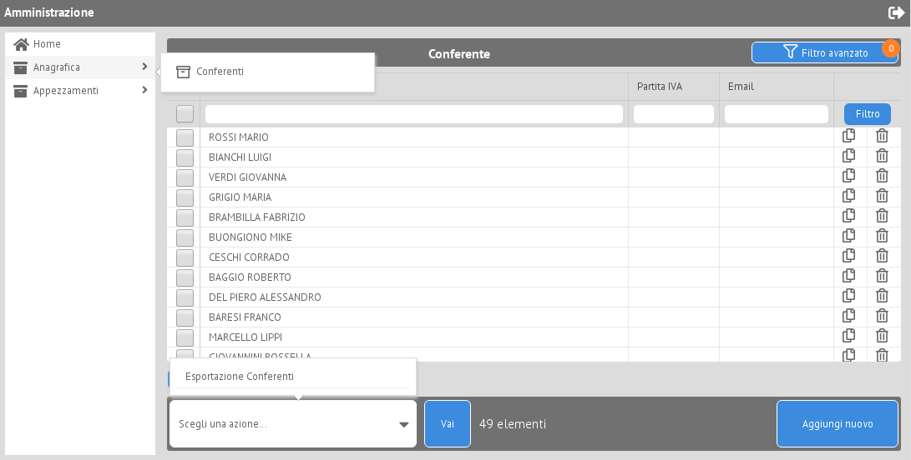
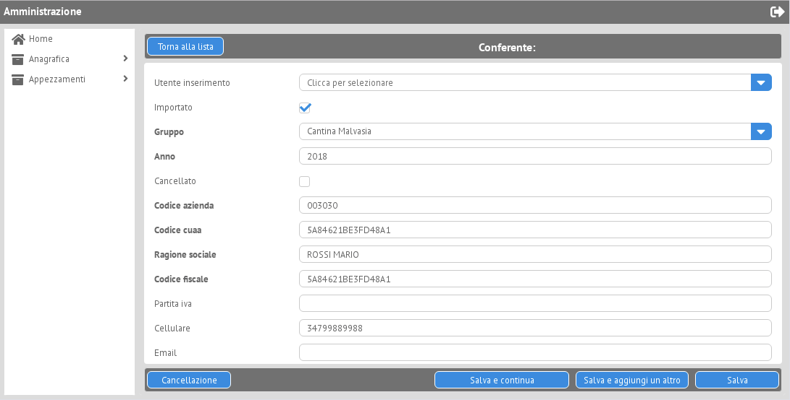

.. _Webix: https://webix.com

==========================
Django-Webix documentation
==========================

Getting started
===============

.. toctree::
   :maxdepth: 2

   readme
   ref/configuration

Django-Webix
============

.. toctree::
   :maxdepth: 2

   ref/forms
   ref/views
   ref/urls
   ref/actions
   class-reference

Contrib
=======

Admin
-----

.. toctree::
   :maxdepth: 2

   contrib/admin/configuration
   contrib/admin/basic_usage
   contrib/admin/site
   contrib/admin/model
   contrib/admin/class-reference

Commands manager
----------------

.. toctree::
   :maxdepth: 2

   contrib/commands_manager/usage
   contrib/commands_manager/class-reference

Filter
------

.. toctree::
   :maxdepth: 2

   contrib/filter/usage
   contrib/filter/class-reference

Auth
----

.. toctree::
   :maxdepth: 2

   contrib/auth/usage
   contrib/auth/class-reference

Sender
------

.. toctree::
   :maxdepth: 2

   contrib/sender/usage
   contrib/sender/customization
   contrib/sender/class-reference

Validator
---------

.. toctree::
   :maxdepth: 2

   contrib/validator/usage
   contrib/validator/class-reference

Package info
============

.. toctree::
   :maxdepth: 1

   class-reference
   contributing
   authors
   changelog

Indices and tables
==================

* :ref:`genindex`
* :ref:`modindex`
* :ref:`search`
